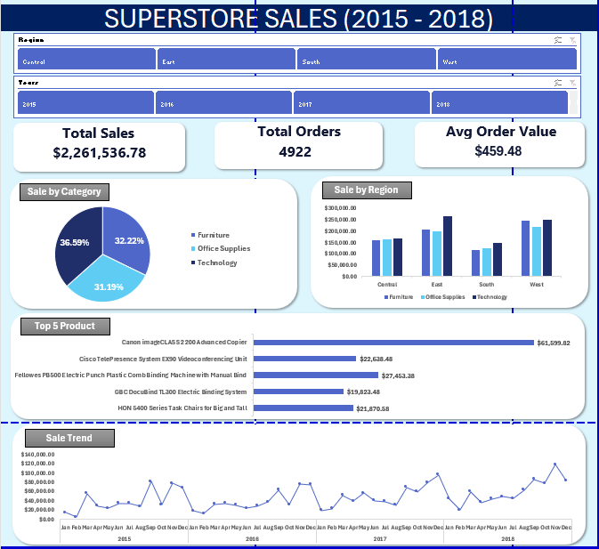

# Superstore Sales Dashboard (2015-2018)

An interactive Excel dashboard that turns 9,800 rows of raw retail sales data into a one-page view of sales performance, built with Power Query, PivotTables, PivotCharts and Slicers.



---

## Table of Contents
- [Business Problem](#business-problem)
- [Objectives](#objectives)
- [Business Questions](#business-questions)
- [Dataset](#dataset)
- [Tools and Skills](#tools-and-skills)
- [Methodology](#methodology)
- [Dashboard Overview](#dashboard-overview)
- [Key Insights](#key-insights)
- [Recommendations](#recommendations)
- [Data Quality Note](#data-quality-note)
- [Limitations](#limitations)
- [Repository Structure](#repository-structure)
- [How to Use](#how-to-use)
- [Author](#author)

---

## Business Problem

Superstore sells products across three categories, four regions and three customer segments. Its sales data sits in a large flat table that is difficult to read manually. Without a centralised view, management cannot easily see:

- how sales are trending over time,
- which categories, regions and products drive revenue, and
- which areas are underperforming.

This project builds a single interactive dashboard that answers these questions at a glance.

## Objectives

1. Clean and prepare the raw sales data for analysis.
2. Build an interactive Excel dashboard to monitor sales performance from 2015 to 2018.
3. Track core KPIs: **Total Sales**, **Total Orders** and **Average Order Value**.
4. Identify trends, top categories, strongest and weakest regions, and best-selling products.
5. Turn the findings into practical, data-backed recommendations.

## Business Questions

| # | Question | Answered by |
|---|----------|-------------|
| 1 | How have sales changed over time? | Sale Trend (line chart) |
| 2 | Which product category contributes the most? | Sale by Category (pie chart) |
| 3 | Which regions perform best and worst? | Sale by Region (bar chart) |
| 4 | Which individual products sell the most? | Top 5 Product (bar chart) |

## Dataset

- **Source:** Superstore Sales dataset (Kaggle)
- **Size:** 9,800 rows, 4,922 unique orders
- **Period:** 2015 to 2018
- **Key fields:** Order ID, Order Date, Ship Mode, Segment, Region, State, Category, Sub-Category, Product Name, Sales

## Tools and Skills

| Area | Detail |
|------|--------|
| Tool | Microsoft Excel |
| Data preparation | Power Query (loading and cleaning) |
| Analysis | PivotTables, Calculated Fields, helper columns |
| Visualisation | PivotCharts (pie, bar, line), KPI cards |
| Interactivity | Slicers (Year, Region) and a reset-filter button |
| Dashboard design | Layout, consistent colour palette, clear chart titles |

## Methodology

1. **Load and clean** the raw data with Power Query into a structured Excel table.
2. **Create a helper column** (`Order Flag`) that marks the first occurrence of each Order ID, so unique orders can be counted correctly in a PivotTable.
3. **Build PivotTables** on a dedicated calculation sheet for each metric and chart.
4. **Add a Calculated Field** for Average Order Value (`Sales / Order Flag`).
5. **Create PivotCharts** and connect all of them to shared slicers so the whole dashboard filters together.
6. **Design the dashboard**: KPI cards on top, slicers for filtering, and four charts below with a consistent colour theme.

## Dashboard Overview

- **KPI cards:** Total Sales, Total Orders, Average Order Value
- **Slicers:** Year and Region, plus a Reset Filter button
- **Charts:**
  - *Sale by Category*: share of sales by product category
  - *Sale by Region*: sales comparison across regions
  - *Sale Trend*: sales over time
  - *Top 5 Product*: best-selling products by sales

All KPIs and charts respond to the slicers.

## Key Insights

> Figures below are for the full period (2015-2018) unless stated otherwise.

- **Total sales of $2.26M** from 4,922 orders, with an average order value of **$459.48**.
- **Sales are growing.** Annual sales went from $480K (2015) to $459K (2016), then $600K (2017) and $722K (2018). That is **+20% growth in 2018** and roughly **14.6% per year** since 2015, despite a small dip in 2016.
- **Technology is the top category** at $827K (about 37% of sales), ahead of Furniture ($729K) and Office Supplies ($705K).
- **Phones ($328K) and Chairs ($323K)** are the top sub-categories, while Fasteners ($3K) is the weakest.
- **West and East regions generate about 61% of sales** ($710K and $670K). **South is the weakest region** at $389K (about 17%).
- **Sales are highly seasonal.** September to December alone contributes about **52%** of sales, while January and February contribute only about **7%**.
- **One product stands out.** The Canon imageCLASS 2200 Advanced Copier is the top seller at about $61.6K, more than double the second-ranked product.
- **Consumer segment** accounts for about 51% of sales.

## Recommendations

1. **Plan inventory and marketing around the Sep-Dec peak**, when about half of annual sales occur, to avoid stock-outs and capture demand.
2. **Run targeted promotions in Jan-Feb** to lift the weakest sales period.
3. **Investigate the South region** (distribution, marketing, competition) to find out why it trails the other regions and set a growth target.
4. **Prioritise Technology and Furniture** for stock and promotion, and review low-value sub-categories such as Fasteners and Labels.
5. **Protect best-selling products** such as the Canon copier through reliable supply, since a few products carry a large share of revenue.

## Data Quality Note

My first version of the dashboard showed **9,800 Total Orders**. This was the number of **rows**, not unique orders, because one order can contain several line items. After adding the `Order Flag` helper column to count distinct Order IDs:

| Metric | Before (wrong) | After (correct) |
|--------|----------------|-----------------|
| Total Orders | 9,800 | **4,922** |
| Average Order Value | $230.77 | **$459.48** |

Lesson: always check how a metric is calculated, not just whether it looks reasonable.

## Limitations

- The dataset has **no Profit, Cost, Quantity or Discount** fields, so the analysis covers sales only. High sales do not necessarily mean high profit.
- Insights describe historical patterns and show correlation, not proven cause and effect.
- Seasonality figures combine all four years and may hide year-to-year differences.

## Repository Structure

```
superstore-sales-dashboard/
├── README.md
├── Superstore_Sales_Dashboard.xlsx    # full workbook (data, pivots, dashboard)
└── images/
    └── dashboard.png                  # dashboard screenshot
```

## How to Use

1. Download `Superstore_Sales_Dashboard.xlsx`.
2. Open it in **desktop Microsoft Excel** (Slicers and PivotCharts do not work fully in Excel Online or on GitHub's preview).
3. Go to the **Dashboard** sheet.
4. Use the **Year** and **Region** slicers to filter, and click **Reset Filter** to clear.

## Future Improvements

- Add Profit, Discount and Quantity data to analyse margins.
- Add a Category slicer and a Sub-Category breakdown.
- Rebuild the dashboard in Power BI for comparison.
- Add forecasting for the 2019 sales trend.

## Author

**Ahmad Naeem Siddiqi bin Ibrahim**
Bachelor of Applied Science (Mathematics Technology), Universiti Tun Hussein Onn Malaysia (UTHM)

- LinkedIn: [add your profile link here]
- GitHub: [add your profile link here]

*Dataset: Superstore Sales dataset from Kaggle.*
